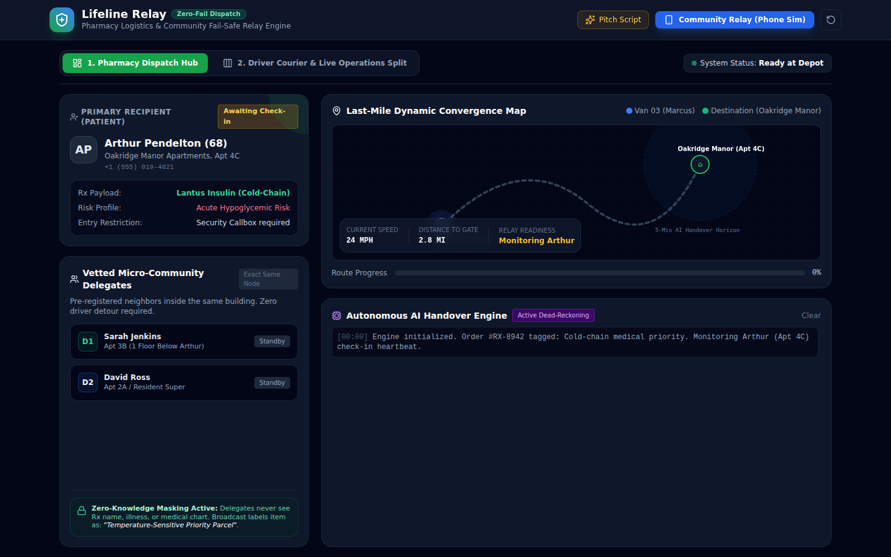

# Lifeline Relay

A delivery tool that helps small neighborhood pharmacies get medication to patients, with AI coordinating the handoff. A team of seven built it in under three hours at an AI hackathon.

- **Try the prototype:** https://ebonypaster.github.io/lifeline-relay/
- **Read the write-up:** https://ebonypaster.com/lifeline-relay
- **See the pitch deck:** [PDF](assets/lifeline-relay-pitch-deck.pdf)

## The problem

Our persona, Arthur, is a single parent who struggles to get insulin deliveries on time. Small neighborhood pharmacies don't have the delivery systems that big chains do. A missed handoff can mean a missed dose.

## What we built

Lifeline Relay helps small pharmacies make faster, more reliable deliveries. It works in four steps.

1. The pharmacy creates a delivery order.
2. The patient names trusted backups, called delegates, who can accept the package.
3. The driver delivers without needing to text while driving.
4. The recipient confirms the handoff with a PIN.

## Where AI comes in

AI acts as a go-between for the driver and the customer. It messages the customer that the package is on the way, collects replies from the customer and their backups, and tells the driver who will meet them.

## How to try it

Open the live link above, or download `index.html` and open it in a browser. It needs an internet connection to load its styles and icons, and it works best on a laptop screen.

1. Click **Community Relay (Phone Sim)** to see all three phones at once.
2. Click **Launch In-Transit Route** to start the delivery.
3. Tap **"I'm ready!"** on Arthur's phone for the normal path, or **Shock (Silent)** to see the backups take over.

## My role

I acted as the team's product manager and led our debugging.

- **Alignment:** I kept seven people who had just met focused on one user and one problem.
- **Communication:** I used our shared slides to track progress and open issues.
- **Quality:** I led the team through dogfooding, which means using your own product the way a customer would so you find problems before they do.

The whole team tested the prototype first. One teammate fixed bugs using AI while the others kept testing. After that round of fixes, one pod tested more closely. Only then did we move on to the marketing and the slides.

## Responsible design

- **Privacy:** Personal information stays between the pharmacy and the customer.
- **Security:** The PIN is meant for the customer and their delegates only, so the recipient can confirm the handoff.
- **Accessibility:** Phone and text options support people who are less comfortable with apps and people with hearing or vision needs.
- **Known gap:** People in rural areas with no nearby delegates can't use it yet.

## What we found, and what we fixed

This is the version we presented. Dogfooding turned up these issues.

**Found and fixed**

- A split view that shows the driver and live operations side by side.
- Combined four screens into two: one for the pharmacy and one for the driver.
- A second backup, so every delivery has two delegates.
- The community phone simulations moved into their own full-screen view.

**Found, fixing next**

- Remove the driver's access to the PIN code.
- Add a backup plan when the last delegate passes.
- Simplify the first backup's phone to Yes and No buttons.
- Confirm the pickup back to Arthur after "I am ready."
- Stop "Yes, heading down" from sending again and again.
- Connect the **Pitch Script** button, which doesn't open anything yet.

## The team

- [Alison Chai](https://www.linkedin.com/in/alisonlchai/)
- [Ebony Paster](https://www.linkedin.com/in/ebonymp/)
- [Xantiago Mukai](https://www.linkedin.com/in/xantiago-mukai-6a991b3bb/)
- Mandy Wang
- Nobody Flowers
- Davion
- [Garv Patel](https://www.linkedin.com/in/garvpatel101/)

## A note on data

This is a hackathon prototype and a simulation. The people, addresses and phone numbers in it are made up, and it is not built to handle real patient information.
